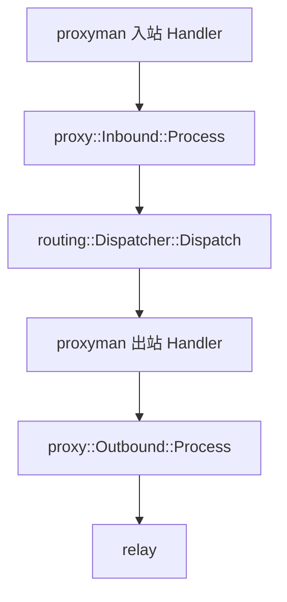

# AGENTS.md

本文件只维护 cnode 的全局工程准则、架构边界与通用机制，不记录目录清单、实现流水、迁移历史或单点修复。仅在约束变化或用户明确要求时更新。

## 协作与交付

- **语言与文档边界**：默认用中文沟通和编写文档，路径、命令、代码与标识符保留原文。`README.md` 维护面向使用者的最短可执行入口、配置、部署和架构概览；本文件维护工程约束。同一事实只维护一处，项目文档冲突时以本文件为准。
- **保护现场**：修改前检查仓库状态，保留用户已有改动，不擅自回退、覆盖或夹带无关修改。目标环境受限或无关改动导致失败时保留现场，不扩大修改范围。
- **自主决策**：能由上下文、现有契约或标准推导时直接执行；仅对实质性歧义或重大权衡提问。
- **交付**：完成本轮整改并通过必要验证后，主动提交、推送相关改动，不另行等待确认。用户要求先交付上一轮时，单独提交推送，不混入本轮在途改动。明确区分已通过、失败、未运行和待外部环境验证的项目。
- **标准与权威**：遵循现行标准、RFC 更新及勘误，区分 MUST/SHOULD/MAY 和收发双方义务，不把发送方限制当成接收方拒绝规则。架构与底层机制优先借鉴同领域权威项目，不以主观“更严格”代替标准。
- **命名与注释**：名称反映职责、对象和动作，禁用无上下文缩写及 `Manager`、`Helper`、`Processor`、`Util`、`Data`、`handle` 等泛称。注释只解释意图、约束、不变量、所有权、生命周期或标准条款，不复述代码。
- **命名空间与外部契约**：C++ 公开类型、函数和常量归属明确的领域命名空间，不用全局 `using` 或兼容命名空间别名保留旧入口。语言或第三方要求的声明位置、原生 I/O 绑定别名，以及线上协议字段、标准库和第三方公开接口的名称与语义保持原样，不做仅改名的包装。
- **源码与产物**：源码、依赖、生成产物分离，按影响范围增量构建；临时验证脚本与产物集中放入构建目录，验证后清理。禁止手改生成代码、为通用分配/I/O 改造侵入打补丁第三方库，或改写已执行的历史迁移；迁移只能追加。

## 设计与安全底线

- **优先级**：正确性与并发安全 > 长期可维护性 > 经实测证明的性能与内存收益。能删则删、能简则简；新设计、抽象和复杂优化必须有可验证收益，至少两个真实调用方共享才提取复用抽象。
- **最小抽象**：采用值所有权、RAII、纯数据聚合、`concept` 与扁平组合；拒绝深层继承、多层虚包装、无类型容器、假想扩展点、单调用方泛型/策略层、无状态包装和纯转发重载。不把同步操作伪装成协程，不把非事务操作伪装成事务。
- **唯一契约与实现**：同类能力只保留一套入口、主链路、状态机与权威编解码/校验算法，且须有当前生产或测试调用。契约变更一次迁移全部调用方、配置、测试和文档，删除旧入口、兼容旁路、死代码、状态与 include；统计/跟踪不得只写不读，不为缩小 diff 留债。内部协议、存储和缓存不引入无外部标准依据的版本号、代次后缀或编号魔数。
- **单向依赖**：模块按职责内聚，跨层只经最小公开契约，依赖保持 DAG；不拆碎片文件或单次调用胶水层。逻辑核心采用 Sans-I/O：借用输入视图产出纯值计划，传输层执行异步 I/O、超时管理并复用已验证句柄，避免 TOCTOU。
- **歧义拒绝**：认证、授权、归属、路由、消息边界或输入输出别名有歧义时直接报错，不猜测、不静默降级、不跨源泄漏凭据。缺失配置与非法/损坏配置严格区分，后者立即阻断；必填、可选、可空、缺失时默认值及“不修改/清空”语义彼此独立。
- **隔离与脱敏**：缓存键及命名空间完整区分影响结果或权限的资源、表示、协议和身份维度。对外错误与日志脱敏；真实凭据不得进入仓库、制品或日志，敏感凭据常量时间比对，临时口令用毕即擦。
- **资源有界**：外部输入驱动的队列、缓存、连接与缓冲须有容量上限、背压或淘汰，以及“阶段无活动 + 整体截止期”双轨超时；嵌套配额只紧不松。分配受实际已到达数据与窗口底线约束并按需几何扩容，禁止按对端声明长度/计数一次性预分配。
- **错误闭环**：区分正常关闭、停机排空、主动取消和异常截断；非致命错误在请求、子流或连接范围隔离，旁路失败不丢主结果，真实异常不静默吞掉。超时、取消、I/O 异常、帧写失败或半关闭后字节归属不明的资源立即中止淘汰，不得归还复用。
- **恢复独立**：热升级、自愈通道与普通业务协议、本地持久化格式解耦，不依赖会被自身停机销毁的会话或终端。

## 请求链路与分层

所有 TCP / UDP / QUIC 请求共用下列主链路；协议只是 Handler 实现，删除任意协议不得影响分发、路由、转发和 Worker。

- **对象模型**：新增或重构主链路组件先对照 Xray-core 对应类型，不发明平行对象模型；保留 C++ 值所有权与单次分派。入站 Handler 构造 session context；出站 Handler 是具体类，持有 `proxy::Outbound`、会话池/mux、sendThrough/流设置，并作为该出站唯一的 Dial 提供者。
- **统一准入**：协议返回认证和目标解析结果；认证后的连接准入、IP 封禁计数、用户上下文、在线设备占位、连接统计与失败收尾只有一个公共入口，不得复制或跳过。物理会话/QUIC 连接认证成功后仅占位一次，子流继承，不随分发重复占位。
- **协议与传输边界**：Hysteria 的 QUIC、HTTP/3 认证、流/数据报会话按 Xray `transport/internet/hysteria` 归传输层，逻辑流或 UDP 会话交给同一入站契约，请求主链路不暴露协议私有流类型。REALITY dest 回落留在传输层，复用公共拨号、转发、准入与统计。原生 datagram、UDP-over-TCP、Mux/子流和回落仅作窄 helper，不承载协议私有架构、panel 字段、选路或第二条请求链路，不自行拨号/转发或绕过限速与统计。
- **单次分派**：协议与出站边界各只允许一次虚调用或无捕获函数指针分派，不叠加 wrapper、adapter、代理 handler、多层虚接口或 `shared_ptr` 句柄转发。注册和绑定只在启动/配置准备期发生。
- **热路径禁项**：不得新增阻塞 I/O、同步锁等待、自旋忙等、mutex/rwlock/spinlock、共享原子争用、`std::function` 链、多余 `shared_ptr`/`weak_ptr` 分配或 `void*`/`shared_ptr<void>` 类型擦除；不得运行期解析配置、读取 panel 原始字段、动态拼键/规则名、逐字节 `AsyncRead`、全表统计扫描、每次握手重建密码学/TLS 上下文，或前后端定时业务轮询。
- **首包与取消**：首包按值移交，作为普通上行的第一份数据；实际读端取消覆盖嗅探、路由 DNS、拨号、握手和转发。多路复用物理写保持帧边界，写失败立即中止底层连接。

上层不得下沉，下层不得理解上层产品语义：

| 层级 | 负责 | 不负责 |
| --- | --- | --- |
| inbound | 认证、协议/目标解析、用户识别、session metadata、调用分发 | 路由、出站连接、转发、访问出站内部、协议私有长期大缓冲 |
| dispatcher | 嗅探、只读路由/策略编排、强制出口、真实路由命中或未命中时的显式 fallback、放行/拒绝、调用 outbound | 协议解析/特判、具体协议/receiver/面板策略类型、转发、panel 字段、伪装路由命中、隐式默认出口 |
| router | 仅在规则真实命中时返回 outbound tag | 连接、转发、协议、强制出口、fallback、隐式默认出口 |
| request policy | 对统一 session 返回 allow / block | 选路、查找 outbound、协议解析、向分发层暴露面板规则类型 |
| outbound | 拨号/下一跳、出站握手与编码、交给转发 | 路由、panel 原始配置、绕过分发、自建拨号目标编排 |
| relay | 搬运数据、流量打点 | 协议解析、选 outbound、panel、连接级大 scratch、wrapper |
| Worker | 事件循环、accept、本执行器能力与生命周期 | 协议校验器、具体协议入口/出站构造、路由决策、panel 同步 |
| proxyman | 按 tag 持有准备好的 handler；receiver 只带不可变窄策略 | 协议/panel 解析、自行选路或转发、跨 Worker 可变 handler |
| transport | 字节传输及上述传输层协议职责 | 代理协议解析、选 outbound、panel 配置、协议私有长期 pool |
| control plane | 拉节点/用户/规则、归一化、构建 runtime、原子发布、按面板语义上报 | 进入热路径、改 live handler、访问 Worker 可变运行态、按协议构建认证凭据 |

## Worker 与跨线程所有权

- **运行拓扑**：一个主线程主控事件循环运行面板、监控、DNSWorker 和全局准入协调器，不接受/转发代理连接；后两者不另建线程/事件循环，不寄生 `Worker 0` 等数据 Worker。数据 Worker 数量启动时固定，运行期不得增删，存活至进程退出。
- **完全同构**：每个数据 Worker 一个线程、一个原生 `io_context`、一组 `SO_REUSEPORT` 监听，使用相同 runtime、监听、入站、出站和路由契约；无 leader、主从或下标专属服务，监听数量不得乘增 Worker 或数据资源。live 能力统一构造、启动、暴露和关闭，同一能力不得有两套实例、查找表或发布路径。
- **本地独占**：每个 Worker 独占入站、出站、路由、分发、策略、连接跟踪、流量计数、限速桶、连接/会话、出站池、定时器与数据面对象。会话终生固定于 Origin Worker；使用、取消、析构均在所属 Worker，私有指针、引用及阶段存储不得跨 Worker 逃逸。禁止跨 Worker 搬迁活跃协程/会话/I/O/分配域/已拨号资源，或转发、复制、排队移交业务包与流载荷；无连接工作由收到它的 Worker 独立完成。
- **共享白名单**：仅允许启动后只读数据、冷路径发布的不可变快照、仅所属执行器写入的统计分片，以及控制面/准入协调/握手静止边界单次 `fd` 移交的有界邮箱。普通转发不走跨线程写队列、共享缓冲或多态写节点；不得用原子或共享引用计数共享 live handler、连接、缓冲池或绕过所有权。
- **全进程 owner**：数据 Worker 所需的全进程可变服务仅由 DNSWorker 与全局准入协调器持有，均经有界投递或预留操作按值交互。DNSWorker 独占 DNS 查询、在途请求、socket、缓存和超时；协调器独占全局/按 IP 连接配额、认证失败封禁、按用户设备配额、SS2022 TCP salt 重放池及跨连接入口目录。Worker 本地只留展示/上报镜像；不得绕过有界入口访问 owner 内部。
- **禁止虚拟执行域**：不在原生事件循环上叠加 `ExecutionDomain`、跨 Worker 会话合组、Socket readiness 拆包层（`NativeSocketHandoff`）或 remote-free 队列。

跨四元组/物理连接的同会话流量只能在入口归集，用户态不转交业务载荷：

- **HY2/QUIC**：各 Worker 在同一 UDP 端口 `SO_REUSEPORT` 监听；服务端 SCID 含 `worker_id`，`SO_ATTACH_REUSEPORT_CBPF` 按 Short Header DCID 投递至 Origin Worker，Long Header 握手按四元组哈希分流。RFC 9000 迁移/NAT 重绑定后仍由 Origin Worker 验证路径并用本地监听 socket 回包，零跨线程交互。每个 HY2 入站只支持固定 UDP 端口，不支持端口集合/范围、跳跃周期或自动防火墙重定向；外部 DNAT 可能隐藏原始目标端口，不得声称能仅凭收包识别或禁止客户端端口跳跃。
- **XHTTP Split-HTTP**：下行 `GET` 的 Origin Worker 独占完整会话、路由、出站和 relay。异 Worker 收到同 `session_id` 的 `stream-up`/`packet-up` 时，只读首个 HTTP 请求头；在无在途 I/O、出站和定时器的静止边界，单次提取入站 `fd`、TLS 状态及预读字节，经有界控制邮箱交 Origin Worker `assign`。此后所有请求/字节均在原 Worker 本地读写，禁止跨 Worker 投递 `MultiBuffer` 或合组活跃 HTTP/2 会话。
- **原生 UDP**：关联及其原生 socket、UDP-over-TCP 隧道/池流由接受并创建它的 Worker 本地独占，对齐 Xray-core/Shadowsocks-rust 的 Share-Nothing 模型；不得迁移出站或跨 Worker 转发数据报。

## C++ 状态、解析与异步生命周期

- **类型表达不变量**：用 `variant` 表达互斥阶段/结果，非法状态不可表示；部分失败同时携带错误与有效进度，结果类别不因移动异常退化。格式损坏、越界、不支持编码以状态码/`optional`/`variant` 返回；系统初始化或不可恢复资源故障直接上报或终止。重复集合唯一查找返回 `absent / found / repeated`；有状态流处理器维持 `active / finished / failed`，仅显式 `reset()` 复用。
- **构造与借用**：构造完成即可用，不设二次初始化；构造失败按已构造计数逆序回滚。借用不延寿，视图不得跨阶段、连接、挂起点或线程保存；编译期拒绝绑定右值临时容器，进入异步前转为所属线程拥有型存储。左值只读借用与右值所有权提取（`&&`）分开；零拷贝接管精确约束类型，防隐式临时对象。持有在途 I/O、定时器或外借 `this` 的宿主禁止拷贝/移动；可移动门面绑定地址稳定的独立状态。
- **数值与别名安全**：整数窄化/转无符号前在原始域校验；单项位掩码查询验证 2 的幂，区分本地严格与线面容错。容量/时长用饱和运算或 `limit - used < delta` 防溢出，正延迟降精度一律 ceil。自借用输入先在独立缓冲构造再替换；嵌套移动赋值先检查自包含；外部指针区间转 `uintptr_t` 后无符号比较、作差。
- **单遍流式解析**：单遍处理语法与转义，禁止预扫后二次遍历或格式化再解析；增量保留已验证偏移，避免 $O(N^2)$，未转义切片零拷贝、按需写时分配。缓冲/帧解码用游标或环形索引，不线性 `erase`/`memmove` 或逐字节循环；完整处理切分、粘包、EOF 与残余归属。共享解码状态遇协议错误回滚当次变更，业务回调拒绝时仍消费完当前块以同步双端。
- **具名控制流**：复杂分支和多阶段异步提为具名函数/协程，避免深层回调/lambda，显式约束捕获及生命周期。同一执行器跨挂起点不假设状态未变；配置提交、物理帧写等共享操作用明确状态机或异步串行门协调。
- **惰性结构化并发**：未启动任务可丢弃，已启动任务必须由 owner 跟踪并 `co_await`/`join` 收束，禁止销毁挂起帧或静默 `detach`；挂起/完成竞争以原子状态机裁决。作用域和投递闭包有析构守卫；跨线程取消经原子可分离指针与代际 ID 的代理投递，等待槽持锁完成结果转移、代际清零解链和唤醒。
- **准入与锁外执行**：非平凡构造/工厂前先栈上快照宿主句柄；有界投递先取得槽位再同步调用工厂，拒绝时完整退回未消费负载。取消、清理、恢复走独立控制通道，不受业务队列满阻塞；锁内只交换指针或摘链，回调、移动、析构在锁外。同线程槽位移交/唤醒延迟至下一轮事件循环，防栈递归；阻塞/CPU 密集任务显式卸载至常驻有界线程池，池内不得自等待，集中式控制面经有界值通道交互。
- **终结顺序**：重置/销毁外部回调包装器时，先 `exchange` 清空内部指针，再移动/析构目标。可能自毁的终结回调前，把回调与状态快照到栈，调用后禁访 `this`；成员按析构反序排布，最先解链的守卫置于末位。取消、删注册项或发布新指针不代表旧使用者退出，回收须覆盖借用、排队回调、在途 I/O。
- **全双工与停机**：单向通道线性互斥，任一方向出错/关闭即唤醒并排空另一方向。停机依次封闭入口、取消或有界排空在途工作、收束全部 I/O/完成通知、按依赖逆序释放组件和阶段存储；`join()` 前防自等待死锁。
- **原子证明**：说明原子保护的状态、发布/读取配对与内存序，不用 atomic 掩盖所有权错误。`atomic<shared_ptr<T>>` 不保证底层无锁，不用于请求路径逐次取快照。声称 lock-free/wait-free 须说明目标平台实现、进展保证和回收条件；CAS 另说明 ABA 与重入处理。

## 分配、热路径与资源回收

- **唯一后端**：统一 mimalloc；daemon 和测试全局替换 malloc/new，测试经链接期 `--wrap` 观察或注入 new/delete 失败，不另行替换全局分配函数。`process_resource()` 是进程生命周期、线程安全的 PMR 适配器，直接使用调用线程原生 mimalloc 堆，不建 Worker/连接/协议级 heap/pool。
- **原生机制优先**：分页、页元数据、空闲块复用、对齐分配、空页回收、延迟 purge 全交 mimalloc；不叠加 slab、块缓存、空闲队列、回收线程、块头、对齐取整或重复系统调用/运行期覆盖。优先原生默认值与构建选项（如 `MI_NO_THP`）；禁用 Asio handler 小块与协程帧缓存（`ASIO_DISABLE_SMALL_BLOCK_RECYCLING`、`ASIO_DISABLE_AWAITABLE_FRAME_RECYCLING`）。
- **默认资源**：可控资源的容器统一使用原生 `std::pmr`，不封装通用 allocator 或容器别名；默认显式绑定 `process_resource()`，接受可空资源的接口在入口归一化 `nullptr`。标准库、第三方或外部契约要求普通容器时在边界转换，普通对象仍使用标准 RAII/智能指针工厂。显式调用方 PMR 优先，寿命由调用方保证；复制时明确目标资源，移动赋值不假定传播资源，`swap` 必须满足资源相等前提。不建无状态选池包装，不按 Worker/执行上下文/应用层 `thread_local` 隐式选池，不替换全局默认 PMR。
- **阶段内存**：monotonic arena 仅用于请求/握手等明确阶段或初始化后封存的同寿命结构；持续流量的 payload、Buffer、子流、队列和会话状态逐块释放，不用连接级 arena。握手、认证、探测、路由、拨号临时缓冲/凭据放在独立子协程，稳态转发前释放；单帧/记录处理完、下次等待前释放借用缓冲和溢出容器，禁止仅 `clear()` 留容量或跨 `co_await` 放数 KiB 栈数组。
- **空闲与长期资源**：等待可读前不预借缓冲；未启动任务组只存 executor，首次 `Spawn` 才建 join 状态与自持有任务组。会话队列空态零分配、排空即释放，采用环形/内联结构，短帧/握手头用栈或 SBO。连接超时统一用执行器调度器，不设每连接常驻定时器、超时协程或堆定时节点。跨请求复用资源由 Worker 本地地址稳定宿主持有，按准入身份/配置快照隔离；短请求结束不销毁健康资源，退役先停新借用，再等已有请求与常驻任务结束。
- **QUIC 轻量化**：`ngtcp2`/`nghttp3` 共用 mimalloc；连接只留协议状态和有界队列，不设独立分配域、`ResidentTaskGroup` 或 `TimeoutSchedulerService`。UDP 队列和超时最小堆按 Worker/监听入口共享；关闭后 ACK 保留、分片、流队列和路径状态须可达地释放。
- **原生回收**：进程资源允许跨线程释放控制面/共享完成状态，不放宽数据面单线程归属，不设执行域租约比对。复用运行时采样，在活动转静默后仅收集一次，再次活动才重新武装，不建额外线程/轮询定时器。统计提交不代表网络静止；强制收集在目标线程执行，仅影响可回收空页，不将 purge 延迟当 RSS 归还期限。
- **职责前移与增量执行**：静态查表/推导在编译期；归一化、规则编译、安全上下文、资源预分配在启动/加载期完成并封存只读；运行期只读执行。同阶段计算、解析、查询只取一次；状态同步和到期清理由真实事件或最近截止时间唤醒，高频变更合并节流，限制单批工作集。

## 协议、配置与控制面

### 协议契约

- 非标准代理协议须依据明确规格与互操作行为；协议义务变更指出条款/规格来源，不用单一对端实现代替契约。未知但合法的扩展不是格式错误，偏离 SHOULD 须说明理由。
- 语法、分帧、安全校验与产品策略分开；资源上限有预算依据，不冒充协议要求。嗅探未识别不等于协议非法，由显式策略决定放行。
- 读写完成、消息完成、连接可复用是不同状态；复用、半关闭、mux 退役须满足协议边界，后续字节归属不明即终止对应流/连接。

### 配置与路由

- 本地/面板输入先在 `infra` 或面板 API 层归一化为纯数据聚合，再进入 runtime；`infra` 不依赖 `app`，不在解析期构造带捕获的运行期工厂。公开配置用可 designated-initialize 的普通聚合，能用字段表达就不加 factory/builder，不以 `void*`、`shared_ptr<void>` 或 `std::function` 擦除已知配置、安全层和请求状态。
- 同字段只保留一份语义校验，来源适配只映射 wire 字段，不复制 REALITY、padding、嗅探、凭据等解析规则。默认 `config.json`，侧车固定 `inbounds.json`、`outbounds.json`、`routing.json`；只接受规范 JSON 顶层，不回退其他格式、旧 sidecar、冗余包装或 legacy/无读者字段。
- 本地键（含 `panels`）在 `infra` 入口按 ASCII 小写归一化，重复即拒绝，不维护多拼写查找，不恢复 snake_case/历史别名。大小写无关枚举与 DNS 名冷路径转小写；路径、Header 值、标签、邮箱、UUID、密码和密钥等不透明值保持原样。面板远端 HTTP wire 字段只在面板 API 内部解析，不向外泄漏。
- 每个 receiver 冷路径明确选择强制出口，或带显式 fallback 的路由；策略不可默认构造或含空 tag。静态 inbound 指定强制出口就不进 Router，否则路由未命中由分发层使用显式 fallback；无 Worker 全局默认出口，不回退第一个 outbound，不伪装规则命中。子流只继承窄策略，不保存完整 receiver。

### 用户、DNS 与发布

- 用户仅走“面板/静态来源、协议构建、用户集合、进程级只读快照、入站只读认证”一条链；禁止第二套用户表，控制面/分发/路由/转发/Worker 不按协议构建认证凭据。快照按协议和 tag 独立发布索引，不为单节点更新拷贝全量协议表。在线设备、连接数等仅保留有消费方的状态，不维护只写不读映射。
- 面板与静态来源共用入站构建、用户发布和 runtime 发布路径，差异止于配置映射。面板资源 tag 使用 `panel/` 前缀并含面板名称、节点 ID。端点准入在控制面完成，不靠 Worker 竞争监听；同 Worker 不同 tag 地址/端口不得重叠，IPv6 固定 v6-only。
- **准备—提交—回滚**：只读方法无副作用；多步变更先构建并校验候选快照和回滚凭据，全部成功才原子提交，失败显式回滚，不在析构中藏异步回滚。局部更新只准备受影响目标，保留未变更资源；清理未完成不开始新变更。失败保留最后提交状态，不提前确认用户同步验证器/ETag，不扩大为数据面中断；不原地改 live 对象图。
- 新只读快照后台全量构建，任一步失败整次放弃；冷路径发布到 Worker 本地视图，仅在操作间隙无锁切换。发布不等于旧引用已退出，按异步生命周期规则完成回收。
- 关键状态落库提交后才确认外部同步凭据或发通知。面板同步和状态心跳独立运行，状态循环只读最后提交状态，失败单独报告；提示流溢出用递增代次引导重建快照。
- 不持数据库事务或互斥锁等待远程 I/O；采用“短事务读/校验租约，释放连接执行远程调用，短事务按版本/租约 CAS 提交”。面板地址回退仅限连接/TLS 握手阶段，开始发送后不换地址重发；批量操作等待全部已启动子任务结束。
- DNS 客户端取消须停止等待并收束投递任务；缓存写入失败不得丢失已取得解析结果。所有查询与缓存操作遵守 DNSWorker 单一 owner 边界。

## 验证、构建与部署

### 按变更范围验证

| 范围 | 必须验证 |
| --- | --- |
| 协议/网络 | 真实客户端、对端或可控回环完成握手与转发，按影响覆盖 TCP/UDP、分段、关闭、取消；不以编译、局部单测、脚本外壳或 mock 回声代替 E2E |
| 生命周期/配置更新 | 成功、失败、取消、回滚、回收；失败不提前确认同步、不遗留任务、不破坏最后生效状态 |
| 基础设施/热路径 | 正确性与生命周期验证之外，按下述性能规则建立可复现对照 |
| 纯文档 | 检查结构、引用、命令与规则一致性，不主动构建或运行代码测试 |

- **测试边界**：缺陷先取得复现证据再验证修复。永久测试保持确定、隔离、并发安全，经公开契约验证可观察行为、边界、转换和错误语义；禁测源码文本、无意义默认值或仅复制/转发的接线。只维护 C++ GoogleTest 单测和真实 E2E，由 CTest 注册/调度；默认关闭、按需构建，普通测试复用生产库，故障注入仅保留必要共享变体。项目自有源码不允许 Python/JavaScript 脚本。
- **性能实证**：所有基础设施/热路径新增、修改、重构默认必须 benchmark，不限性能优化。修改前建基线；相同环境、固定负载/编译选项交错重复，记录版本、命令、负载、范围与波动，按影响比较吞吐、延迟、CPU、分配和内存。覆盖真实操作与关键边界，请求链路补真实 E2E 负载对照；微基准不代表端到端吞吐。新增能力选明确可比基线，不虚构变更前结果；性能不替代正确性/并发/生命周期验证。用户明确要求不运行时跳过，并报告未验证，不宣称性能验收通过；环境不足同样处理。
- **优化内存红线**：不得以内存上涨换 CPU/吞吐，不扩大连接缓冲、队列或缓存预算。同负载同时比较空闲/预热后 RSS 与峰值内存；未验证内存不增长不得宣称优化验收通过。
- **构建唯一入口**：编译/测试规则只在根 `CMakeLists.txt`，不拆自有 `.cmake` 模块。依赖清单和 overlay 入口只在 `vcpkg.json`，不设版本基线/固定版本覆盖，跟随最新 vcpkg 端口；overlay 仅承载上游端口缺失补丁，仅保留 vcpkg 必需配方、triplet、musl 工具链。工具版本由 mise 管理，TLS/QUIC 只用 BoringSSL。
- **平台与命令**：Linux 发布仅 musl 全静态；本地默认 `CNODE_ENABLE_LTO=OFF`，仅 CI 开启 `-DCNODE_ENABLE_LTO=ON`。构建/测试命令以当前 CMake 和现有入口为准；平台差异在可用目标环境验证，不把单平台结果当跨平台证明。README 命令注明平台、shell 与前置条件，只描述已实现且可验证的入口，不写内部细节、工程规范、变更流水或排障记录。
- **部署**：更新脚本无参数时只更新二进制和 geo；geo 先下载到临时目录，失败保留旧文件，内容变化后重启原服务，不改既有 panel/sidecar 配置。符号文件只在显式要求时下载；线上诊断优先发布产物，不默认在目标机临时编译。
